# Awesome Fable 5.2 Videos

Videos, motion graphics, 3D scenes and games people made with **Claude Fable 5.2** in the first ~48 hours after launch — each with the prompt the creator shared (or, where no prompt was published, their original post).

Almost every video here was made by asking Fable 5.2 to produce the animation as *code* (Blender Python, HTML, Canvas, SVG, Three.js and friends) — no video model involved. Pick one, copy its prompt, and try it with your own agent.

- 64 posts curated from X in [`data/videos.json`](data/videos.json), each with a page in [`prompts/`](prompts/)
- Video cover images included in [`assets/posters/`](assets/posters/)
- 11 of them include the creator's actual prompt, ready to copy
- Every entry links to the creator's original post
- Latest update (2026-11-10): first collection, gathered on launch day

## Contents

- [Official](#official) (1)
- [Motion graphics](#motion-graphics) (37)
- [3D scenes](#3d-scenes) (16)
- [Games & interactive](#games--interactive) (7)
- [Explainers](#explainers) (3)
- [How to use a prompt](#how-to-use-a-prompt)
- [Credits](#credits)

## Official

<table>
<tr><td width="33%" valign="top"><a href="https://x.com/claudeai/status/2119867114450268322">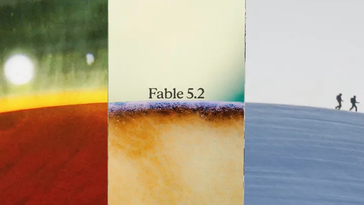</a> <a href="https://x.com/claudeai/status/2119867114450268322"><b>@claudeai</b></a> · <a href="prompts/claudeai-268322.md">Prompt</a> launch</td></tr>
</table>

## Motion graphics

<table>
<tr><td width="33%" valign="top"> <a href="https://x.com/Khazix0918/status/2119902325460590834"><b>@Khazix0918</b></a> · <a href="prompts/khazix0918-590834.md">Prompt</a> motion-graphics · music-video</td><td width="33%" valign="top"><a href="https://x.com/mattshumer_/status/2119884041331892403">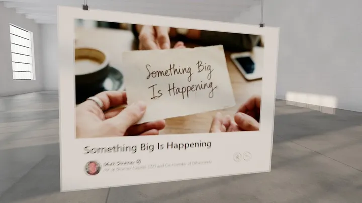</a> <a href="https://x.com/mattshumer_/status/2119884041331892403"><b>@mattshumer_</b></a> · <a href="prompts/mattshumer-892403.md">Prompt</a> pure-code · one-shot</td><td width="33%" valign="top"> <a href="https://x.com/mattshumer_/status/2119900920347828670"><b>@mattshumer_</b></a> · <a href="prompts/mattshumer-828670.md">Prompt</a> pure-code · voice · music</td></tr>
<tr><td width="33%" valign="top"><a href="https://x.com/anabology/status/2120010995309457643">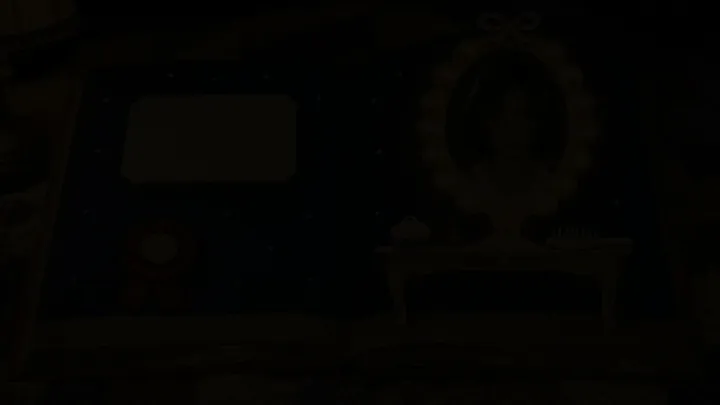</a> <a href="https://x.com/anabology/status/2120010995309457643"><b>@anabology</b></a> · <a href="prompts/anabology-457643.md">Prompt</a> pure-code · long-form</td><td width="33%" valign="top"><a href="https://x.com/suna_gaku/status/2119952985933697063">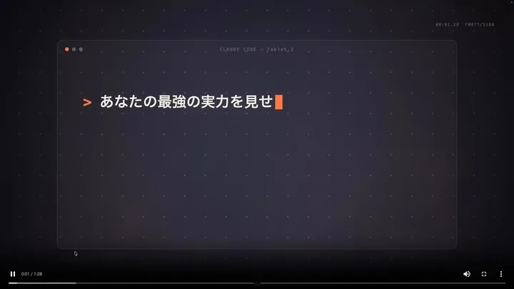</a> <a href="https://x.com/suna_gaku/status/2119952985933697063"><b>@suna_gaku</b></a> · <a href="prompts/suna-gaku-697063.md">Prompt</a> pure-code · music · one-shot</td><td width="33%" valign="top"><a href="https://x.com/developedbyed/status/2119898145777983634">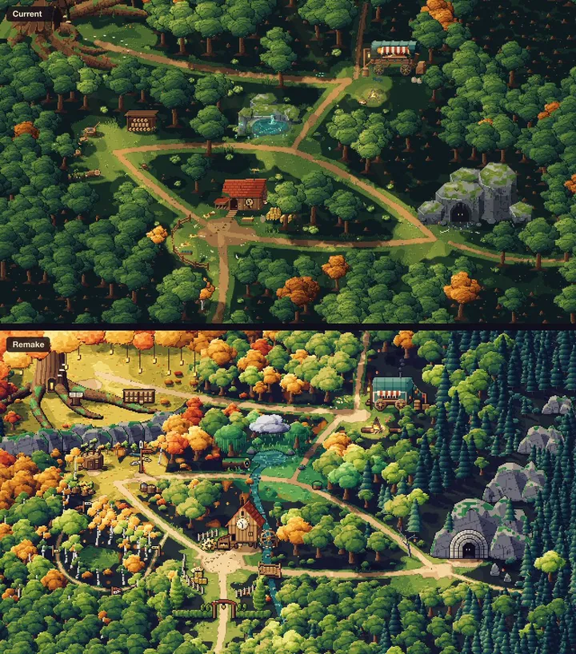</a> <a href="https://x.com/developedbyed/status/2119898145777983634"><b>@developedbyed</b></a> · <a href="prompts/developedbyed-983634.md">Prompt</a> comparison</td></tr>
<tr><td width="33%" valign="top"><a href="https://x.com/ivanainai/status/2119915243321397550">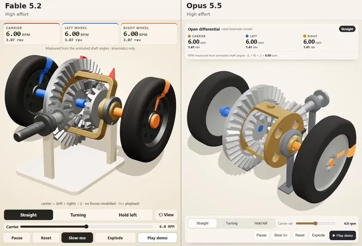</a> <a href="https://x.com/ivanainai/status/2119915243321397550"><b>@ivanainai</b></a> · <a href="prompts/ivanainai-397550.md">Prompt</a> comparison · vibe-coding</td><td width="33%" valign="top"><a href="https://x.com/Gregoirechp/status/2119879667457073355">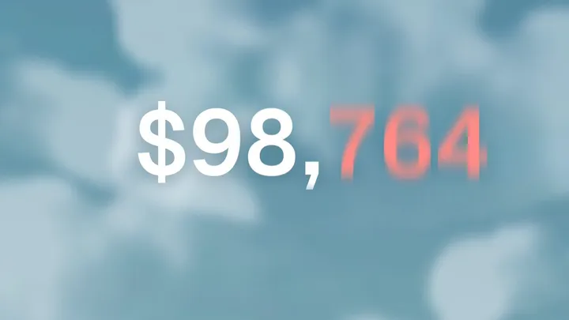</a> <a href="https://x.com/Gregoirechp/status/2119879667457073355"><b>@Gregoirechp</b></a> · <a href="prompts/gregoirechp-707355.md">Prompt</a> motion-graphics</td><td width="33%" valign="top"><a href="https://x.com/devsvn2/status/2119875516216070289">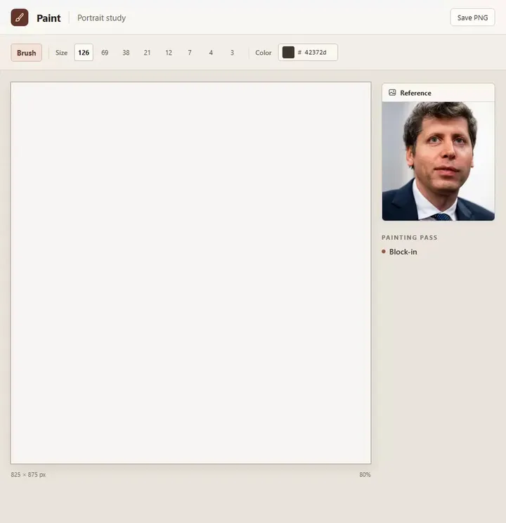</a> <a href="https://x.com/devsvn2/status/2119875516216070289"><b>@devsvn2</b></a> · <a href="prompts/devsvn2-070289.md">Prompt</a> one-shot</td></tr>
<tr><td width="33%" valign="top"><a href="https://x.com/dfeinition/status/2119881243990859818">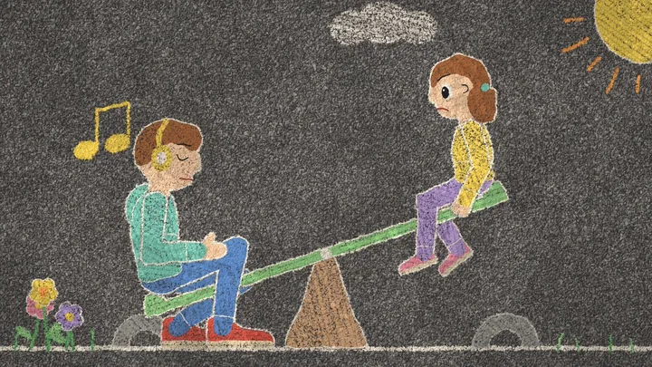</a> <a href="https://x.com/dfeinition/status/2119881243990859818"><b>@dfeinition</b></a> · <a href="prompts/dfeinition-859818.md">Prompt</a> chalk · style</td><td width="33%" valign="top"><a href="https://x.com/seanaiux/status/2119888254753505512">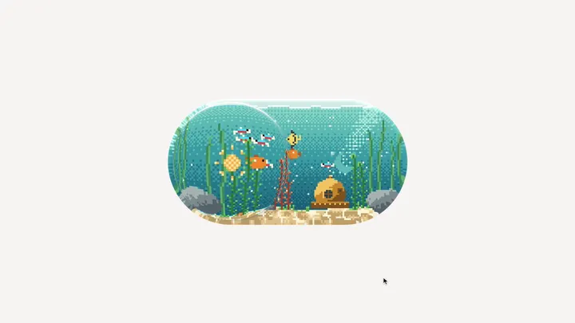</a> <a href="https://x.com/seanaiux/status/2119888254753505512"><b>@seanaiux</b></a> · <a href="prompts/seanaiux-505512.md">Prompt</a> pixel-art · CSS · UI</td><td width="33%" valign="top"><a href="https://x.com/Leviwoyun/status/2119955625820258308">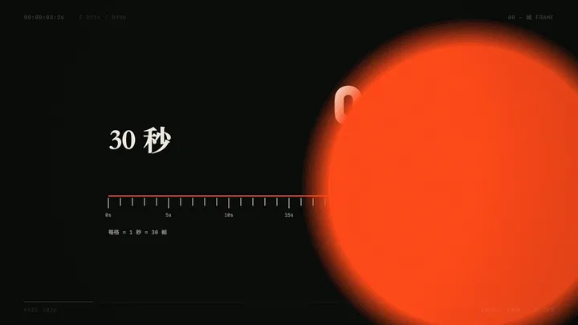</a> <a href="https://x.com/Leviwoyun/status/2119955625820258308"><b>@Leviwoyun</b></a> · <a href="prompts/leviwoyun-258308.md">Prompt</a> motion-graphics · music</td></tr>
<tr><td width="33%" valign="top"><a href="https://x.com/Leviwoyun/status/2120053612131037492">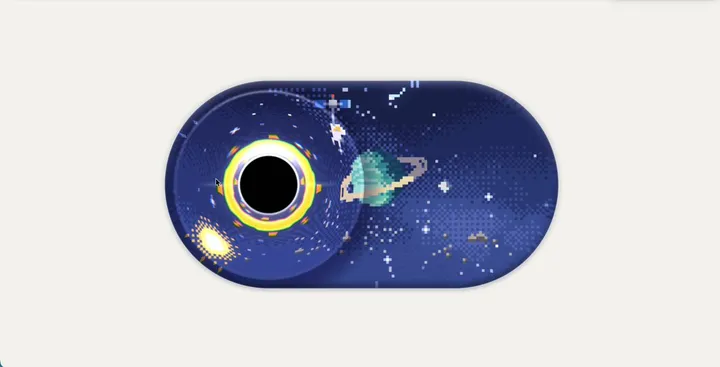</a> <a href="https://x.com/Leviwoyun/status/2120053612131037492"><b>@Leviwoyun</b></a> · <a href="prompts/leviwoyun-037492.md">Prompt</a> 3D · UI</td><td width="33%" valign="top"><a href="https://x.com/GKev1n/status/2119923603785617868">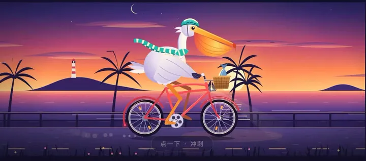</a> <a href="https://x.com/GKev1n/status/2119923603785617868"><b>@GKev1n</b></a> · <a href="prompts/gkev1n-617868.md">Prompt</a> SVG · pelican</td><td width="33%" valign="top"><a href="https://x.com/leo114119/status/2119943368079802645">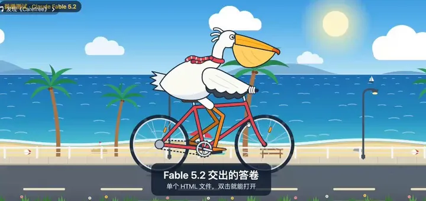</a> <a href="https://x.com/leo114119/status/2119943368079802645"><b>@leo114119</b></a> · <a href="prompts/leo114119-807264.md">Prompt</a> SVG · pelican</td></tr>
<tr><td width="33%" valign="top"><a href="https://x.com/leo114119/status/2119989377132630075">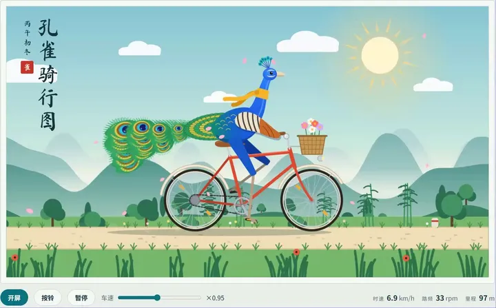</a> <a href="https://x.com/leo114119/status/2119989377132630075"><b>@leo114119</b></a> · <a href="prompts/leo114119-630075.md">Prompt</a> SVG · peacock</td><td width="33%" valign="top"><a href="https://x.com/leo114119/status/2119945755100373293">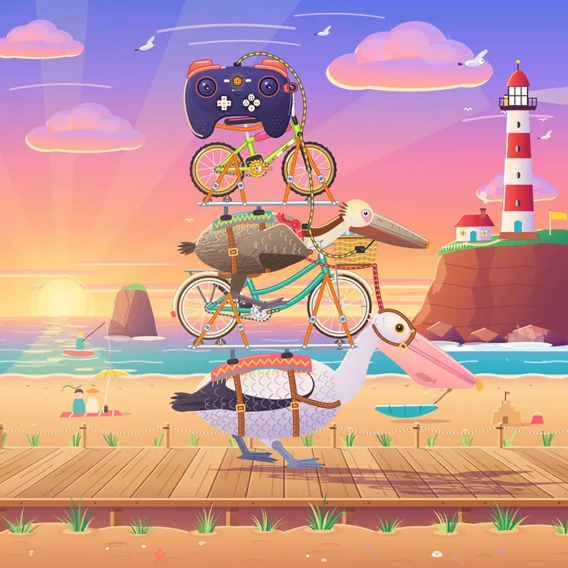</a> <a href="https://x.com/leo114119/status/2119945755100373293"><b>@leo114119</b></a> · <a href="prompts/leo114119-037293.md">Prompt</a> SVG · pelican · recursion</td><td width="33%" valign="top"><a href="https://x.com/aziz4ai/status/2119928581405200726">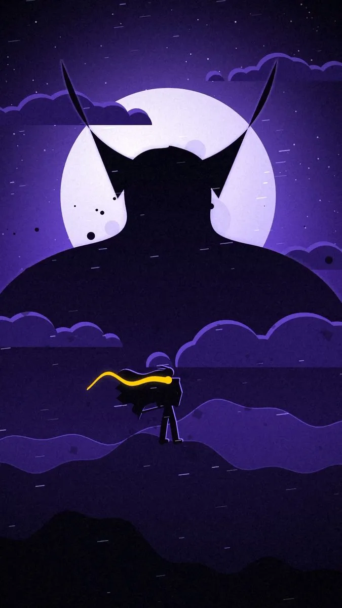</a> <a href="https://x.com/aziz4ai/status/2119928581405200726"><b>@aziz4ai</b></a> · <a href="prompts/aziz4ai-200726.md">Prompt</a> pure-code · motion-graphics</td></tr>
<tr><td width="33%" valign="top"><a href="https://x.com/ohayou792/status/2119994876926587380">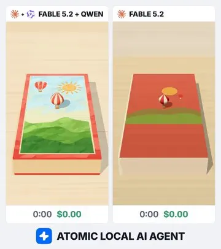</a> <a href="https://x.com/ohayou792/status/2119994876926587380"><b>@ohayou792</b></a> · <a href="prompts/ohayou792-587380.md">Prompt</a> 3D · flip-book</td><td width="33%" valign="top"><a href="https://x.com/FreedomAIG/status/2120017167848763821">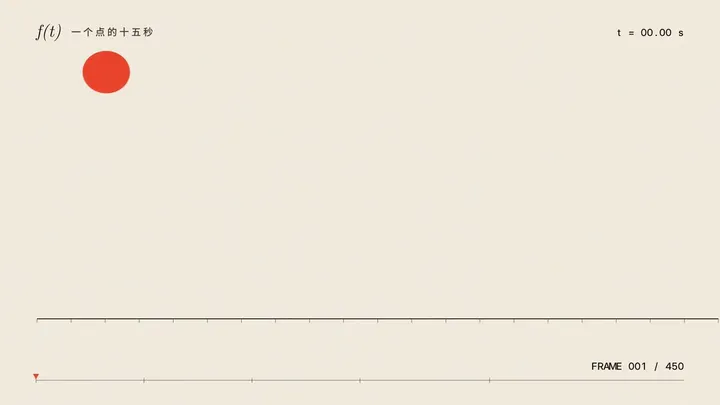</a> <a href="https://x.com/FreedomAIG/status/2120017167848763821"><b>@FreedomAIG</b></a> · <a href="prompts/freedomaig-763821.md">Prompt</a> ink-wash · comparison</td><td width="33%" valign="top"><a href="https://x.com/amihai/status/2119894821255205099">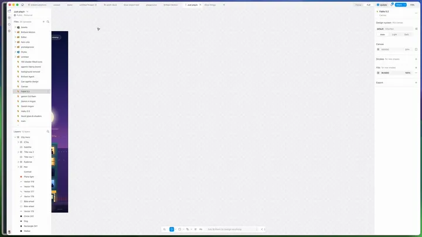</a> <a href="https://x.com/amihai/status/2119894821255205099"><b>@amihai</b></a> · <a href="prompts/amihai-205099.md">Prompt</a> Canvas</td></tr>
<tr><td width="33%" valign="top"><a href="https://x.com/fiapp_pro/status/2119998595059585134">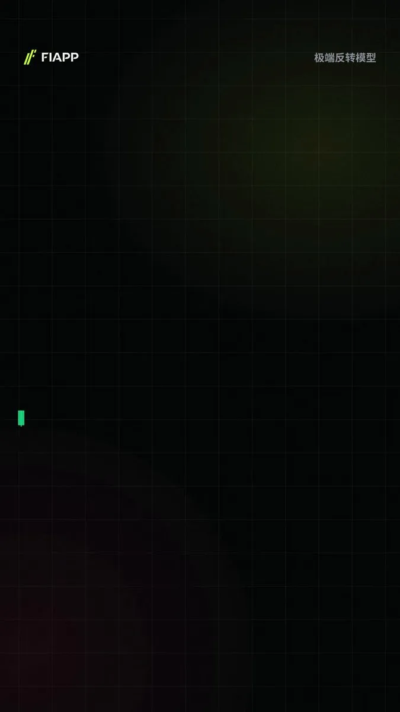</a> <a href="https://x.com/fiapp_pro/status/2119998595059585134"><b>@fiapp_pro</b></a> · <a href="prompts/fiapp-pro-585134.md">Prompt</a> motion-graphics</td><td width="33%" valign="top"><a href="https://x.com/LovekeshAnand07/status/2120024384685613199">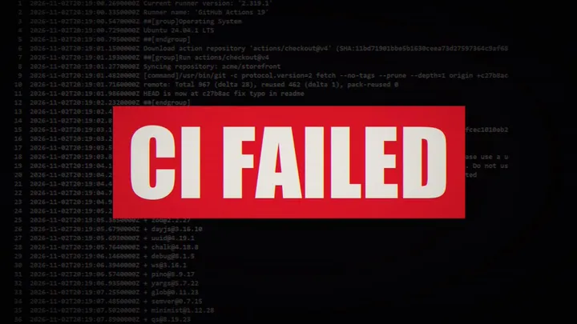</a> <a href="https://x.com/LovekeshAnand07/status/2120024384685613199"><b>@LovekeshAnand07</b></a> · <a href="prompts/lovekeshanand07-613199.md">Prompt</a> launch-video · one-shot</td><td width="33%" valign="top"><a href="https://x.com/devteamdrew/status/2119892540950241283">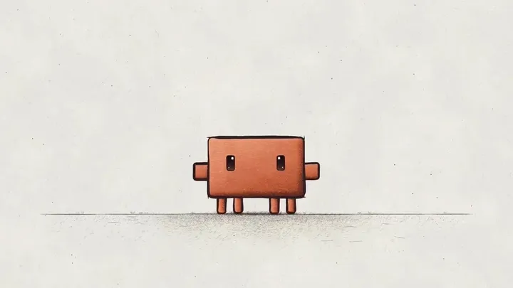</a> <a href="https://x.com/devteamdrew/status/2119892540950241283"><b>@devteamdrew</b></a> · <a href="prompts/devteamdrew-241283.md">Prompt</a> motion-graphics</td></tr>
<tr><td width="33%" valign="top"><a href="https://x.com/vibe_walking/status/2119994132269842784">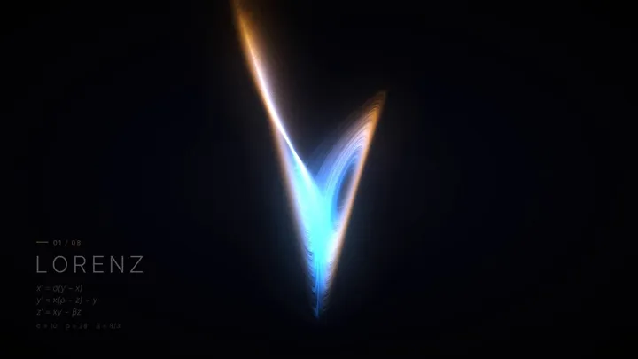</a> <a href="https://x.com/vibe_walking/status/2119994132269842784"><b>@vibe_walking</b></a> · <a href="prompts/vibe-walking-842784.md">Prompt</a> background · web</td><td width="33%" valign="top"><a href="https://x.com/qwjcool/status/2120051782009393425">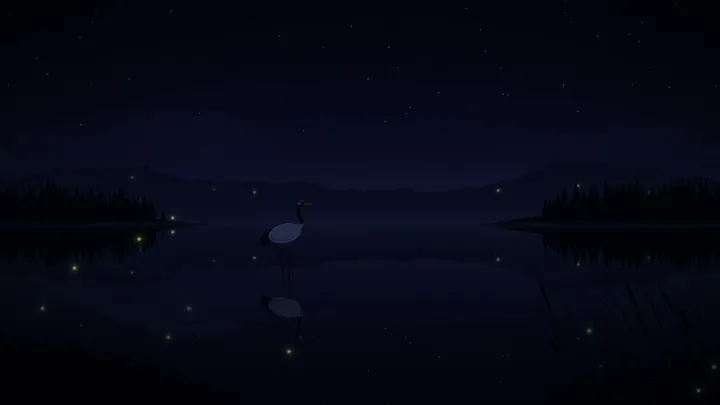</a> <a href="https://x.com/qwjcool/status/2120051782009393425"><b>@qwjcool</b></a> · <a href="prompts/qwjcool-393425.md">Prompt</a> nature · music</td><td width="33%" valign="top"><a href="https://x.com/wshuyi/status/2120014892040417720">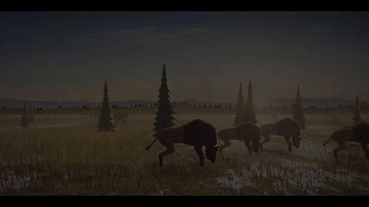</a> <a href="https://x.com/wshuyi/status/2120014892040417720"><b>@wshuyi</b></a> · <a href="prompts/wshuyi-417720.md">Prompt</a> pure-code · sfx · no-skills</td></tr>
<tr><td width="33%" valign="top"><a href="https://x.com/akokoi1/status/2119986791474491817">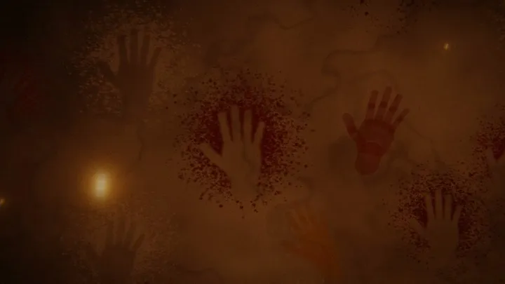</a> <a href="https://x.com/akokoi1/status/2119986791474491817"><b>@akokoi1</b></a> · <a href="prompts/akokoi1-491817.md">Prompt</a> art-history · one-shot</td><td width="33%" valign="top"><a href="https://x.com/miyataArcHack/status/2120066807088529420">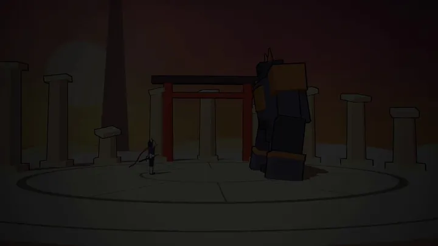</a> <a href="https://x.com/miyataArcHack/status/2120066807088529420"><b>@miyataArcHack</b></a> · <a href="prompts/miyataarchack-529420.md">Prompt</a> battle · animation</td><td width="33%" valign="top"> <a href="https://x.com/RJasonHA/status/2120041766363574444"><b>@RJasonHA</b></a> · <a href="prompts/rjsonha-574444.md">Prompt</a> stickman · fight · physics</td></tr>
<tr><td width="33%" valign="top"><a href="https://x.com/Yuziyyaa/status/2120031965034471752">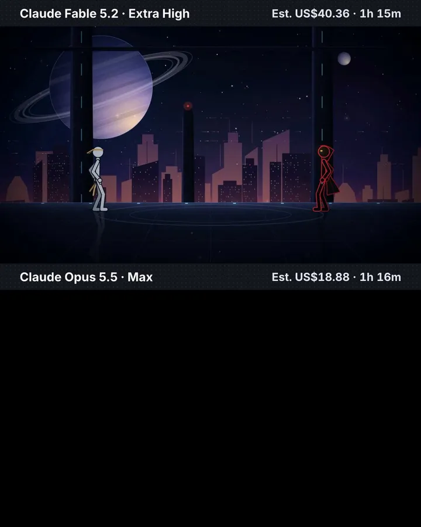</a> <a href="https://x.com/Yuziyyaa/status/2120031965034471752"><b>@Yuziyyaa</b></a> · <a href="prompts/yuziyyaa-471752.md">Prompt</a> stickman · comparison</td><td width="33%" valign="top"><a href="https://x.com/EianLu/status/2120052032157409493">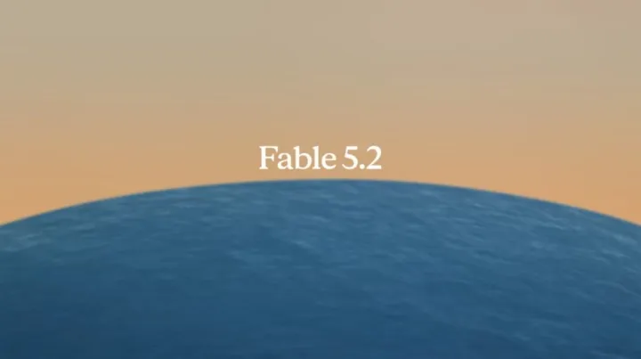</a> <a href="https://x.com/EianLu/status/2120052032157409493"><b>@EianLu</b></a> · <a href="prompts/eianlu-409493.md">Prompt</a> replication · comparison</td><td width="33%" valign="top"><a href="https://x.com/mathiaschpl/status/2119878412181676283">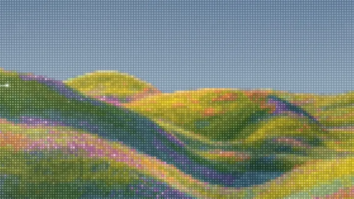</a> <a href="https://x.com/mathiaschpl/status/2119878412181676283"><b>@mathiaschpl</b></a> · <a href="prompts/mathiaschpl-676283.md">Prompt</a> motion-graphics · fast</td></tr>
<tr><td width="33%" valign="top"> <a href="https://x.com/hello_amani/status/2119873980786237842"><b>@hello_amani</b></a> · <a href="prompts/hello-amani-837842.md">Prompt</a> 3D · animation</td><td width="33%" valign="top"><a href="https://x.com/berryxia/status/2119947402107089168">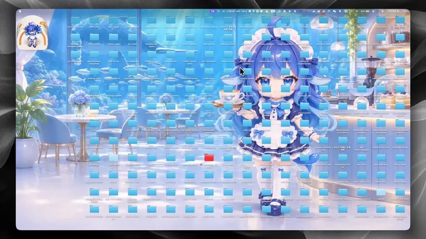</a> <a href="https://x.com/berryxia/status/2119947402107089168"><b>@berryxia</b></a> · <a href="prompts/berryxia-089168.md">Prompt</a> robot · iteration</td><td width="33%" valign="top"><a href="https://x.com/yihui_indie/status/2119964172171755762">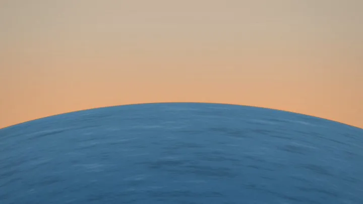</a> <a href="https://x.com/yihui_indie/status/2119964172171755762"><b>@yihui_indie</b></a> · <a href="prompts/yihui-indie-175762.md">Prompt</a> Skill · 4K · launch-video</td></tr>
<tr><td width="33%" valign="top"><a href="https://x.com/karminski3/status/2120007187808534965">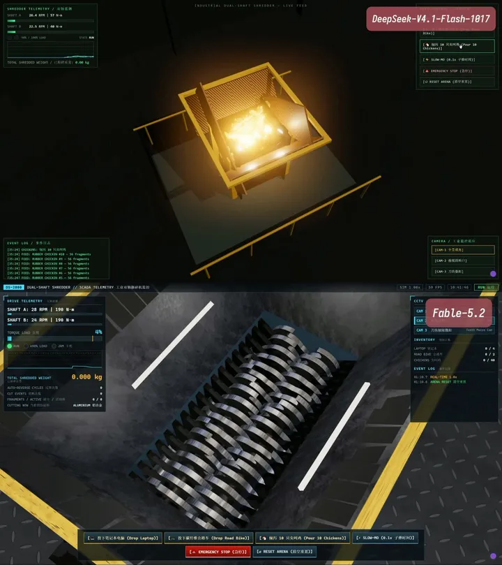</a> <a href="https://x.com/karminski3/status/2120007187808534965"><b>@karminski3</b></a> · <a href="prompts/karminski3-534965.md">Prompt</a> comparison</td></tr>
</table>

## 3D scenes

<table>
<tr><td width="33%" valign="top"><a href="https://x.com/rileybrown/status/2119902109709537708">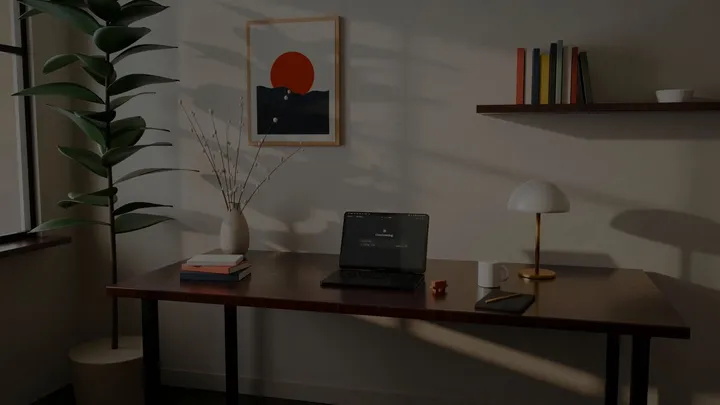</a> <a href="https://x.com/rileybrown/status/2119902109709537708"><b>@rileybrown</b></a> · <a href="prompts/rileybrown-537708.md">Prompt</a> Blender · Python · RunPod · ElevenLabs · 4K</td><td width="33%" valign="top"> <a href="https://x.com/jeremyberman/status/2119869358679712206"><b>@jeremyberman</b></a> · <a href="prompts/jeremyberman-712206.md">Prompt</a> Blender · Python</td><td width="33%" valign="top"> <a href="https://x.com/LexnLin/status/2119880654858977333"><b>@LexnLin</b></a> · <a href="prompts/lexnlin-577333.md">Prompt</a> 3D · subagents</td></tr>
<tr><td width="33%" valign="top"><a href="https://x.com/YxzRainy/status/2119928520595935551">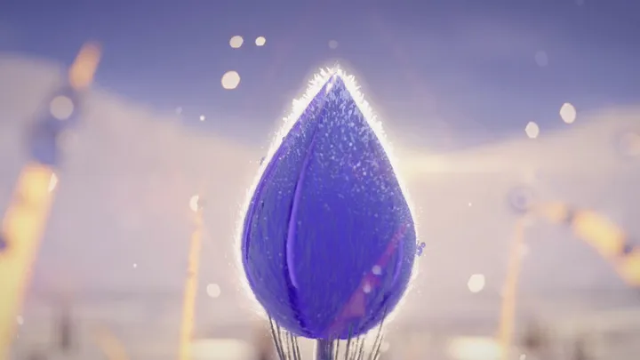</a> <a href="https://x.com/YxzRainy/status/2119928520595935551"><b>@YxzRainy</b></a> · <a href="prompts/yxzrainy-595551.md">Prompt</a> 3D · subagents</td><td width="33%" valign="top"><a href="https://x.com/Stefan_3D_AI/status/2120041169719894165">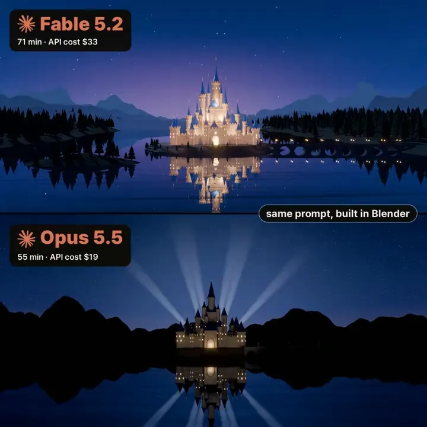</a> <a href="https://x.com/Stefan_3D_AI/status/2120041169719894165"><b>@Stefan_3D_AI</b></a> · <a href="prompts/stefan-3d-ai-694165.md">Prompt</a> Blender · procedural · comparison</td><td width="33%" valign="top"><a href="https://x.com/getviewgum/status/2119991792053387264">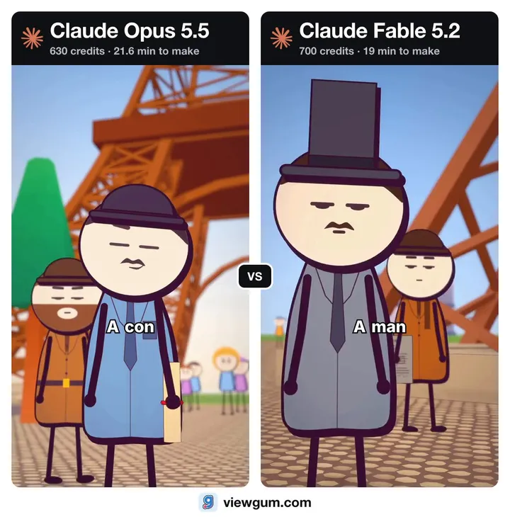</a> <a href="https://x.com/getviewgum/status/2119991792053387264"><b>@getviewgum</b></a> · <a href="prompts/getviewgum-587264.md">Prompt</a> 3D · comparison</td></tr>
<tr><td width="33%" valign="top"><a href="https://x.com/aimlapi/status/2119889097053409682">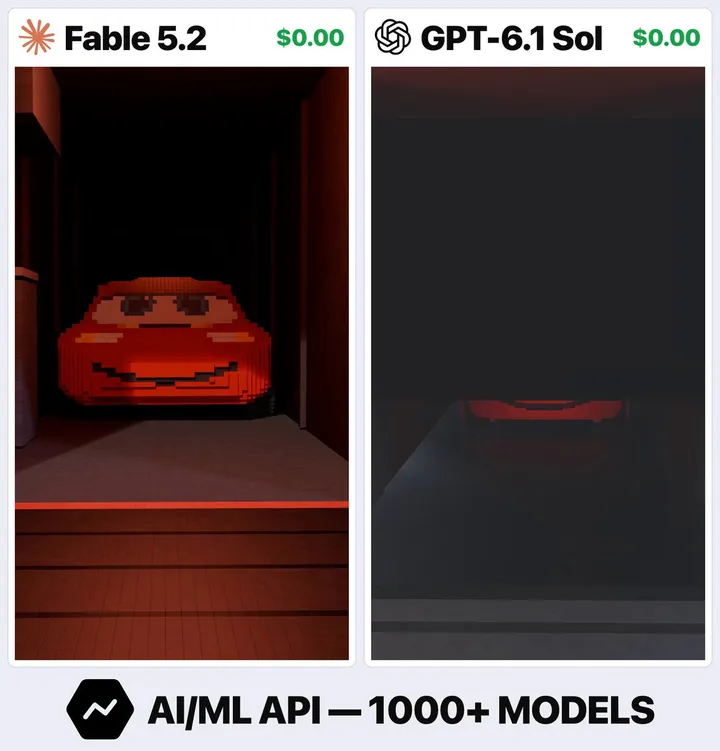</a> <a href="https://x.com/aimlapi/status/2119889097053409682"><b>@aimlapi</b></a> · <a href="prompts/aimlapi-409682.md">Prompt</a> voxels · 3D · comparison</td><td width="33%" valign="top"><a href="https://x.com/leo114119/status/2119934826111451495">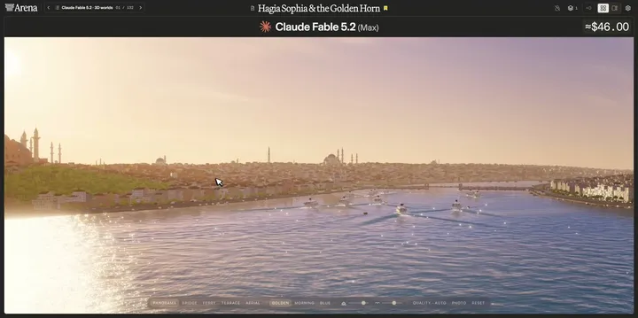</a> <a href="https://x.com/leo114119/status/2119934826111451495"><b>@leo114119</b></a> · <a href="prompts/leo114119-141745.md">Prompt</a> 3D · city</td><td width="33%" valign="top"><a href="https://x.com/leo114119/status/2119932921415151723">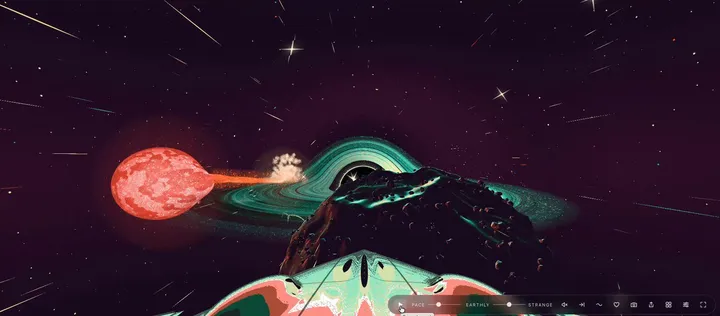</a> <a href="https://x.com/leo114119/status/2119932921415151723"><b>@leo114119</b></a> · <a href="prompts/leo114119-515723.md">Prompt</a> 3D · simulation · pure-code</td></tr>
<tr><td width="33%" valign="top"> <a href="https://x.com/leo114119/status/2119950111958831350"><b>@leo114119</b></a> · <a href="prompts/leo114119-883350.md">Prompt</a> Blender · 3D</td><td width="33%" valign="top"><a href="https://x.com/leo114119/status/2119934353367347445">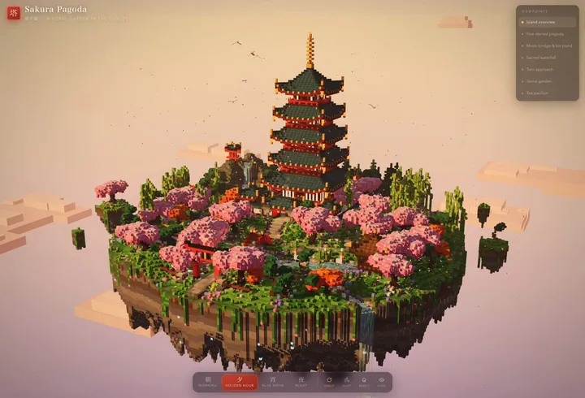</a> <a href="https://x.com/leo114119/status/2119934353367347445"><b>@leo114119</b></a> · <a href="prompts/leo114119-347445.md">Prompt</a> voxels · 3D</td><td width="33%" valign="top"><a href="https://x.com/leo114119/status/2119928576548237346">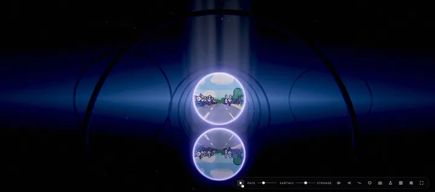</a> <a href="https://x.com/leo114119/status/2119928576548237346"><b>@leo114119</b></a> · <a href="prompts/leo114119-673746.md">Prompt</a> 3D · pelican · pure-code</td></tr>
<tr><td width="33%" valign="top"><a href="https://x.com/duoyun_77/status/2120026864333045860">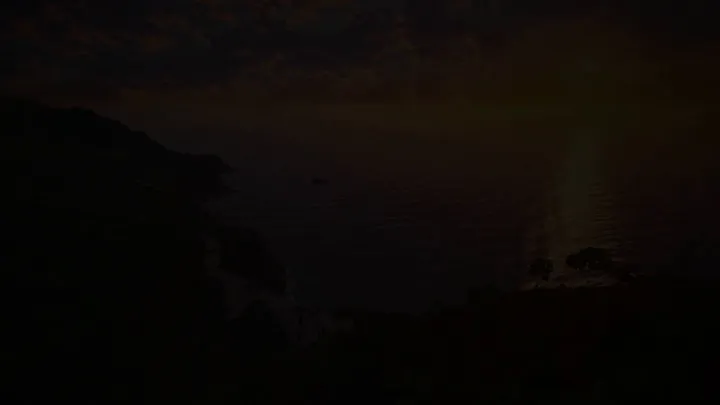</a> <a href="https://x.com/duoyun_77/status/2120026864333045860"><b>@duoyun_77</b></a> · <a href="prompts/duoyun-77-045860.md">Prompt</a> 3D · earth · interactive</td><td width="33%" valign="top"><a href="https://x.com/KHvostikk/status/2119939061049889130">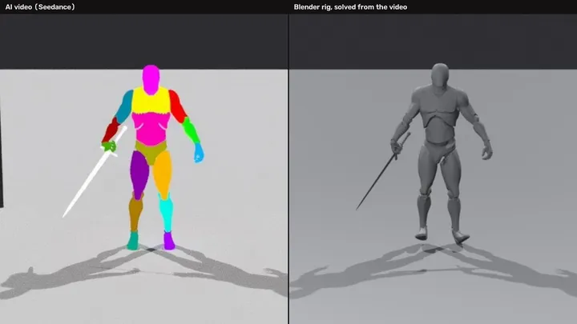</a> <a href="https://x.com/KHvostikk/status/2119939061049889130"><b>@KHvostikk</b></a> · <a href="prompts/khvostikk-889130.md">Prompt</a> 3D</td><td width="33%" valign="top"> <a href="https://x.com/seiiiiiiiiiiru/status/2119919169768747313"><b>@seiiiiiiiiiiru</b></a> · <a href="prompts/seiiiiiiiiiiru-747313.md">Prompt</a> Blender</td></tr>
<tr><td width="33%" valign="top"> <a href="https://x.com/JamesDa55049936/status/2120028680026259589"><b>@JamesDa55049936</b></a> · <a href="prompts/jamesda-259589.md">Prompt</a> 3D · cinematic</td></tr>
</table>

## Games & interactive

<table>
<tr><td width="33%" valign="top"><a href="https://x.com/kevin_t_ngo/status/2119868968307695818"><b>A boat ride through 8 dreamlike worlds — playable in the browser</b></a> <a href="https://x.com/kevin_t_ngo/status/2119868968307695818"><b>@kevin_t_ngo</b></a> · <a href="prompts/kevin-t-ngo-695818.md">Prompt</a> game · playable · 3D · aesthetics</td><td width="33%" valign="top"><a href="https://x.com/felixrieseberg/status/2119925633564463609">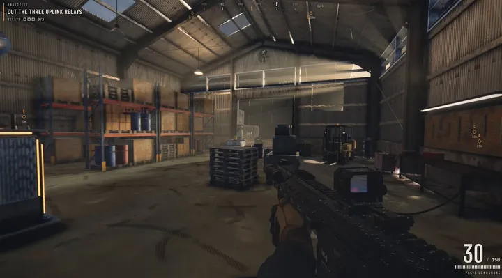</a> <a href="https://x.com/felixrieseberg/status/2119925633564463609"><b>@felixrieseberg</b></a> · <a href="prompts/felixrieseberg-463609.md">Prompt</a> game · FPS · playable · one-shot</td><td width="33%" valign="top"><a href="https://x.com/fly3nn/status/2119974687157715156">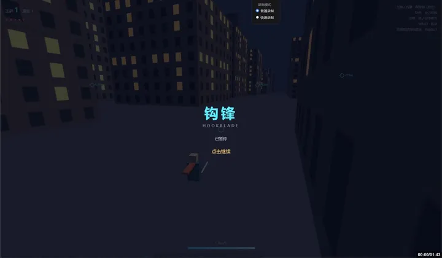</a> <a href="https://x.com/fly3nn/status/2119974687157715156"><b>@fly3nn</b></a> · <a href="prompts/fly3nn-715156.md">Prompt</a> game · one-shot</td></tr>
<tr><td width="33%" valign="top"><a href="https://x.com/Stargridcompass/status/2119989441322529138">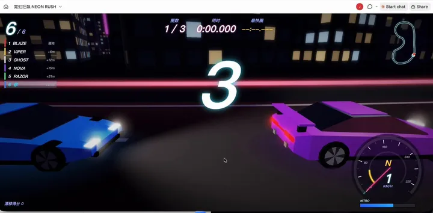</a> <a href="https://x.com/Stargridcompass/status/2119989441322529138"><b>@Stargridcompass</b></a> · <a href="prompts/stargridcompass-529138.md">Prompt</a> game · racing · comparison</td><td width="33%" valign="top"><a href="https://x.com/aiwaremax/status/2119942626325701089">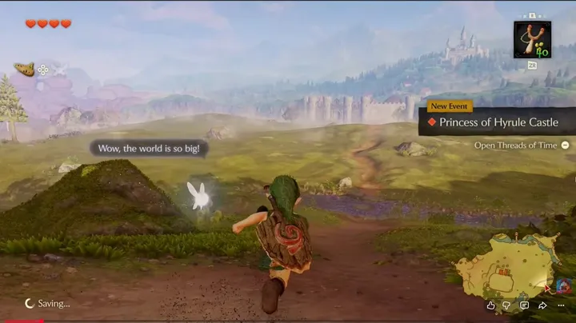</a> <a href="https://x.com/aiwaremax/status/2119942626325701089"><b>@aiwaremax</b></a> · <a href="prompts/aiwaremax-701089.md">Prompt</a> game · zelda · 3D</td><td width="33%" valign="top"><a href="https://x.com/leo114119/status/2119999332682223795">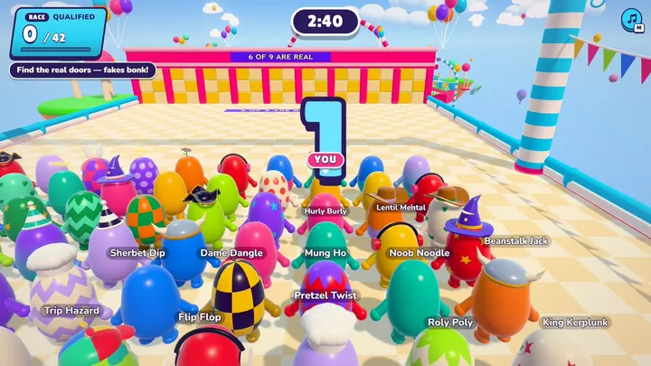</a> <a href="https://x.com/leo114119/status/2119999332682223795"><b>@leo114119</b></a> · <a href="prompts/leo114119-223795.md">Prompt</a> game · remake</td></tr>
<tr><td width="33%" valign="top"> <a href="https://x.com/FutureStacked/status/2120066532856221889"><b>@FutureStacked</b></a> · <a href="prompts/futurestacked-221889.md">Prompt</a> interactive · demo · hardware-concept</td></tr>
</table>

## Explainers

<table>
<tr><td width="33%" valign="top"> <a href="https://x.com/diegocabezas01/status/2119978348440866912"><b>@diegocabezas01</b></a> · <a href="prompts/diegocabezas01-866912.md">Prompt</a> Python · simulation</td><td width="33%" valign="top"> <a href="https://x.com/linxiaobei888/status/2119978892861829227"><b>@linxiaobei888</b></a> · <a href="prompts/linxiaobei888-829227.md">Prompt</a> education · kids · animation</td><td width="33%" valign="top"> <a href="https://x.com/Egichzz/status/2120067587606200515"><b>@Egichzz</b></a> · <a href="prompts/egichzz-200515.md">Prompt</a> LilyPond · music · notation</td></tr>
</table>

## How to use a prompt

1. Open a prompt page from the table above (or browse [`prompts/`](prompts/)).
2. Paste the prompt into Claude with the Fable 5.2 model selected.
3. Let it write and run the code — Blender Python, an HTML file, an SVG animation… — then iterate in plain language (`slower camera`, `more particles`, `loop it`).

Prompts marked with a full **Prompt** section are verbatim from the creator; entries showing **Original post** did not publish a reusable prompt, so the post itself is the best available starting point.

## Credits

Every video belongs to its creator — follow the links in the tables and show them some love. Special thanks to:

- [@rileybrown](https://x.com/rileybrown) for the one-prompt 4K Clawd short and its full prompt, and [@JamesDa55049936](https://x.com/JamesDa55049936) for publishing the prompt in full
- [@felixrieseberg](https://x.com/felixrieseberg) (Anthropic) for the one-shot AAA web game stress test
- [@LexnLin](https://x.com/LexnLin) for the launch-day viral 3D scene
- Anthropic / [@claudeai](https://x.com/claudeai) for Fable 5.2

Collected from public posts on X on 2026-11-10, the day Claude Fable 5.2 launched. Engagement numbers are snapshots from collection time.

Inspired by [awesome-opus5-5-videos](../awesome-opus5-5-videos) — same idea, one model generation later.
